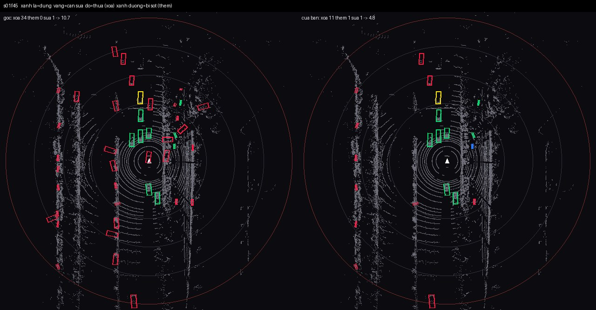
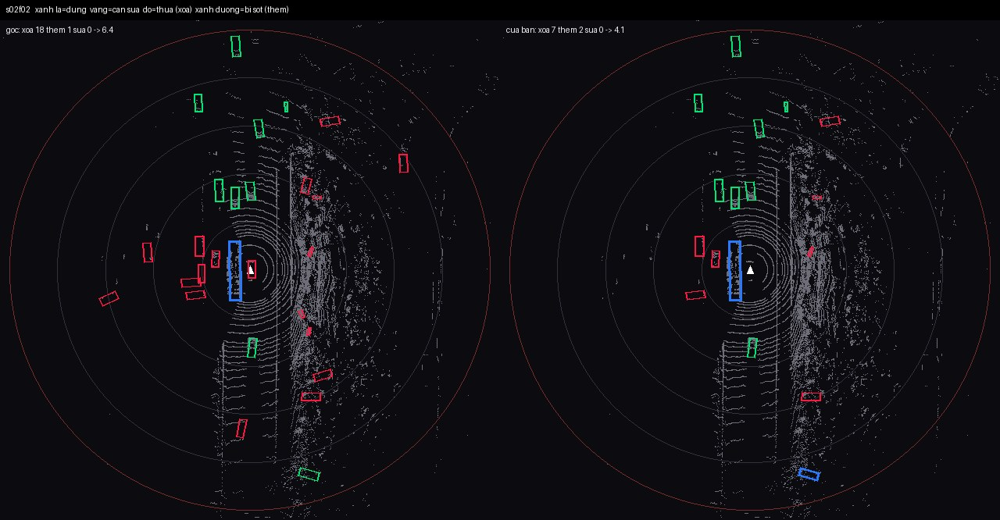
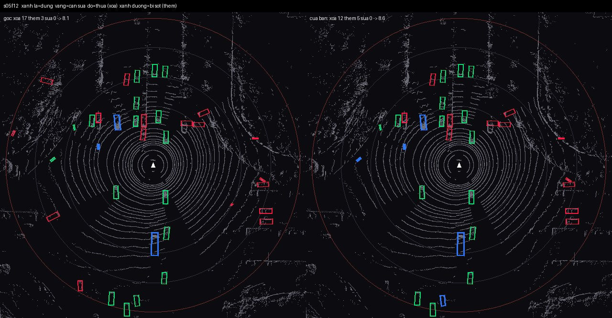

# Báo cáo Day 14 — Lê Minh Thắng — 2A202603292

- Mã học viên: `2A202603292`
- seed_tag: `82ac3100fd`

## 1. Dự đoán trước sweep (bước 5b)

- Tham số tôi nghĩ giảm công sửa nhiều nhất:
  score_thr = 0.4 và min_points = 5.

- Vì sao: Quan sát tập A, mô hình tạo nhiều box thừa,
  nhận nhầm cây, vỉa hè và các vật thể không phải phương tiện.
  Tổng số box giảm từ 105 xuống 40 sau khi chỉnh sửa.
  Tôi dự đoán tăng ngưỡng độ tin cậy và số điểm LiDAR tối thiểu
  sẽ giúp giảm số box thừa và công sửa thủ công.

## 2. Tập A: sửa tay và tune

| Cấu hình | Xóa | Thêm | Sửa | Chi phí |
|---|---:|---:|---:|---:|
| Gốc | 69 | 4 | 1 | 25.2 |
| `best_config.json` | 30 | 8 | 1 | 17.5 |

### Tham số tối ưu

- `score_thr`: tăng từ 0.1 lên 0.5.
- `min_points`: giữ nguyên bằng 0.
- Tổng số cấu hình thử nghiệm: 15.

### Kết quả leave-one-out

| Frame | score_thr | min_points | Chi phí | Tốt nhất có thể |
|---|---:|---:|---:|---:|
| s01f45 | 0.5 | 0 | 4.8 | 4.8 |
| s02f02 | 0.5 | 0 | 4.1 | 4.1 |
| s05f12 | 0.5 | 0 | 8.6 | 8.1 |

Cả 3 lần leave-one-out đều chọn cấu hình score_thr=0.5
và min_points=0.

Cấu hình tương đối ổn định. Tuy nhiên, chi phí trên frame
s05f12 tăng nhẹ từ 8.1 lên 8.6.

Tôi vẫn chọn cấu hình này vì tổng chi phí chỉnh sửa
trên tập A giảm từ 25.2 xuống 17.5.

## 3. Trước/sau (bước 8)

### Frame s01f45

### Frame s02f02

### Frame s05f12

### Kết quả so sánh

| Frame | Chi phí gốc | Chi phí sau tune |
|---|---:|---:|
| s01f45 | 10.7 | 4.8 |
| s02f02 | 6.4 | 4.1 |
| s05f12 | 8.1 | 8.6 |
| Tổng | 25.2 | 17.5 |

`scripts/pp_compare.py` báo giảm 31% công sửa trên tập A.

- Số box cần xóa giảm từ 69 xuống 30.
- Số box cần thêm tăng từ 4 lên 8.
- Số box cần sửa giữ nguyên là 1.

Dự đoán ở mục 1 đúng một phần. Việc tăng ngưỡng confidence
giúp giảm đáng kể số box thừa và tổng chi phí chỉnh sửa.

Tuy nhiên, ngưỡng tối ưu thực tế là 0.5 thay vì 0.4.
Tham số min_points=5 không mang lại cải thiện thêm
so với min_points=0 tại ngưỡng confidence 0.5.

## 4. Tập B

Số đo từ `scripts/pp_prelabel.py
--frames d14_2A202603292/frames_B.txt
--config d14_2A202603292/best_config.json
--gt d14_2A202603292/ref_B.json`:

- Tổng số frame: 12.
- Tổng số box AI dự đoán: 174.
- Tổng số box ground truth: 125.
- Số box khớp: 115.

| Xóa | Thêm | Sửa | Chi phí |
|---:|---:|---:|---:|
| 59 | 10 | 1 | 28.2 |

Box thừa là loại lỗi tốn nhiều công xử lý nhất,
với 59 box cần xóa, tương ứng chi phí 17.7.

Trong quá trình gán nhãn, tôi cũng phải bổ sung
một số đối tượng Truck, Bus và Cyclist bị bỏ sót,
đồng thời điều chỉnh kích thước và vị trí cuboid.

## 5. Giới hạn

- Tập A chỉ gồm 3 frame để tối ưu tham số,
  chưa đủ đại diện cho mọi tình huống giao thông.
- Mô hình PointPillars pretrained trên KITTI không có
  lớp Truck và Bus riêng nên có thể nhận diện sai
  hoặc bỏ sót các đối tượng này.
- Tăng ngưỡng confidence giúp giảm box thừa
  nhưng có thể làm tăng số box bị bỏ sót.
- Chi phí chỉnh sửa được tính theo công thức,
  chưa phản ánh chính xác thời gian chỉnh sửa thực tế.
- Chất lượng ground truth phụ thuộc vào độ chính xác
  của quá trình gán nhãn thủ công.